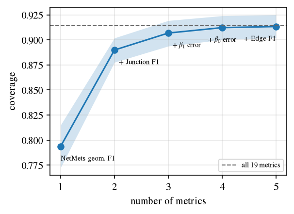
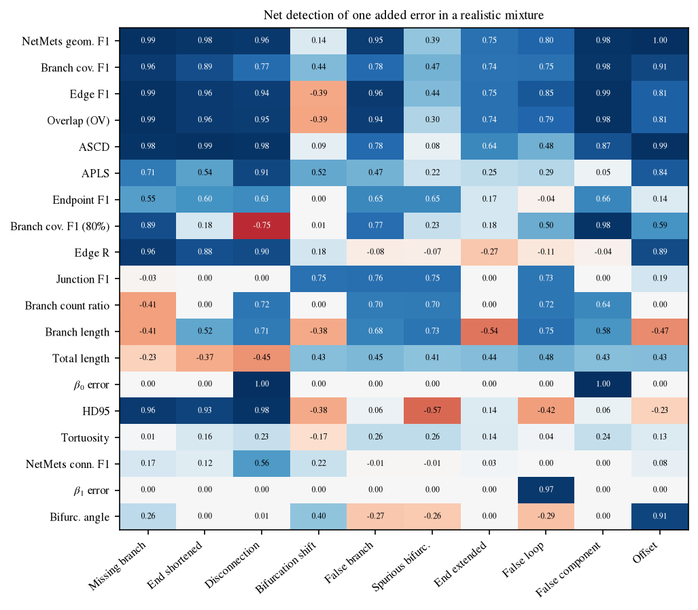
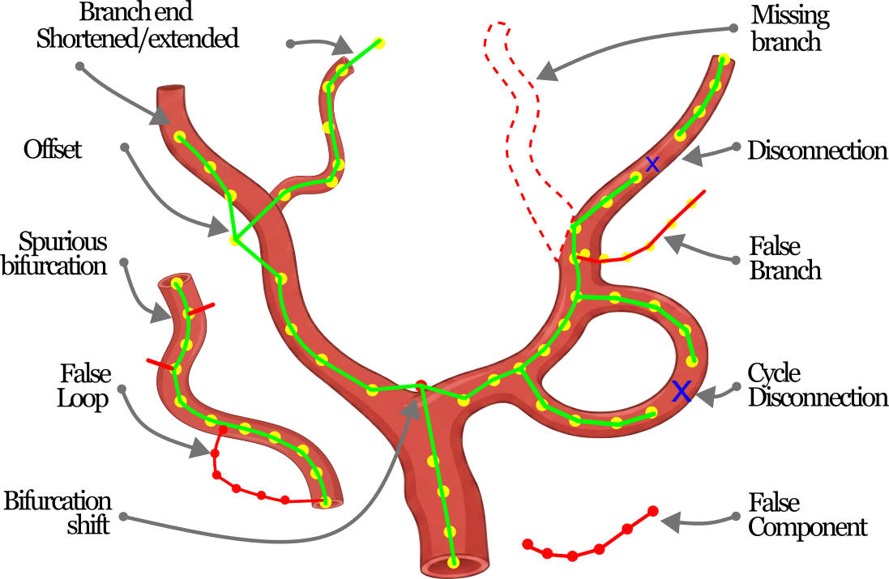
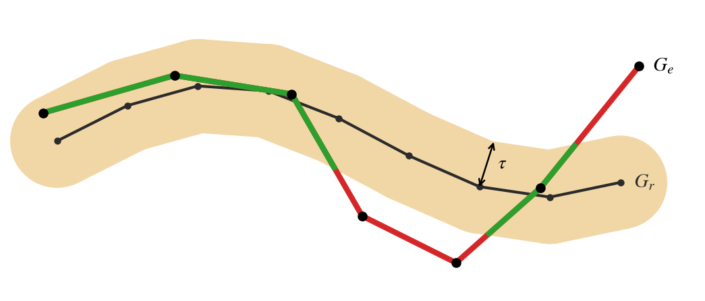
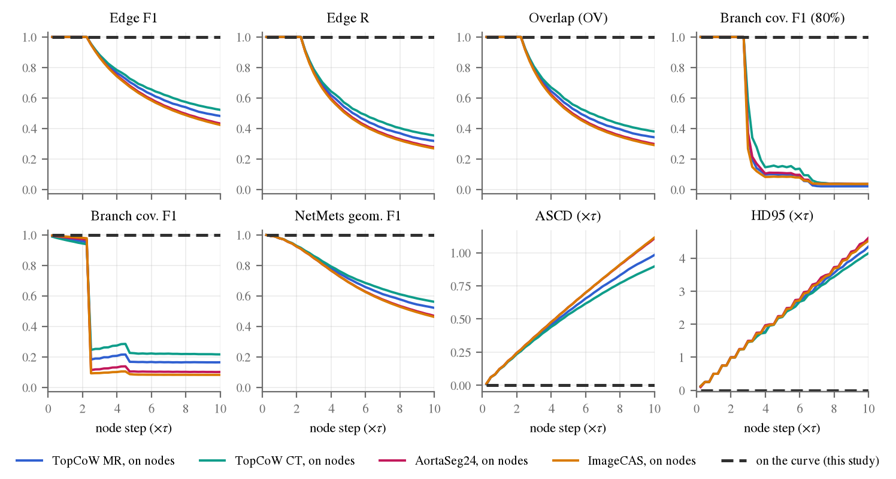

# ceval

Evaluation of centerline graphs. `ceval` compares a predicted centerline graph with a
reference graph under one protocol. By default it reports the four recommended metrics, and
it can report all metrics from the paper.

## Which metrics to report

Report these four metrics together as one set:

| Metric | Key | What it measures | Why it is in the set |
|---|---|---|---|
| **NetMets geom. F1** | `netmets_geom_F1` | Geometric agreement along the vessels | The best single metric under mixed errors |
| **Junction F1** | `junction_F1` | Detection and localisation of branching points | The only metric that reliably detected a bifurcation shift (net detection 0.75) |
| **β1 error** | `beta1_err` | Error in the number of independent cycles | The only metric in the set that responded strongly to a false loop (net detection 0.97) |
| **β0 error** | `beta0_err` | Error in the number of connected components | Detected every disconnection and false component (net detection 1.00); 45% of the 1,220 evaluated graphs contained one of these errors |

We injected errors into mixtures built from the error profiles of 1,220 graphs from four
published methods and tested every set of up to five of the nineteen metrics, on 5,537 pairs
of graphs. NetMets geom. F1, Junction F1 and β1 error together reached 99% of the coverage of
all nineteen metrics and were the best set in 992 of 1,000 bootstrap replicates. β0 error is
added because connectivity errors are common in evaluated graphs.

<p align="center"></p>

*Coverage as metrics were added one at a time, with 95% confidence intervals.*

- NetMets geom. F1 can be replaced by Edge F1 or ASCD (average symmetric centerline distance,
  Liu et al. 2025 [[doi]](https://doi.org/10.1002/mp.17855)), at a coverage loss of 0.02 to 0.04.
- β1 error can be left out when both graphs are constrained to be loop-free.
- Other metrics can be added for a specific question with `--all-metrics`, for example HD95
  for the largest geometric deviations.
- We do not recommend the node metrics, which change with node spacing, or total length
  alone. Total length rated the more damaged graph as better in 61% to 73% of the pairs in
  which vessel was removed.



*No metric detects every error. Net detection of one added error in a mixture of errors: 1
means that the metric always ranked the more damaged graph as worse, and negative values mean
that it more often ranked it as better.*

## Errors tested



## Independent of node spacing

The curve metrics compare the curves themselves, so they do not depend on where either graph
places its nodes. Eight metrics that change with node spacing when computed on nodes are
computed on the centerlines instead. The node metrics (`node_F1`, `chamfer`, `false_merges`,
`false_splits`) depend on node spacing and are reported separately only with `--all-metrics`
or `--long-report`. The tolerance is recorded with every score.



*Coverage on the centerline: the evaluated graph is covered where it lies within τ of the
reference (green) and uncovered elsewhere (red).*



*The same centerline with different node spacing: computed on the nodes, the values change
(coloured lines); computed on the centerline, they stay perfect (dashed line).*

## Quick start (Docker)

```bash
docker build -t ceval .
docker run --rm -v "$PWD/examples:/data" ceval \
    /data/prediction.vtp /data/reference.vtp --d-mm 0.7 -o /data/report.json
```

`examples/` holds a small synthetic vessel tree (`reference.vtp`) and the same tree with one
branch removed (`prediction.vtp`). The report is written to `examples/report.json`.

## Output

By default the report gives the four recommended metrics: `netmets_geom_F1`, `junction_F1`,
`beta1_err` and `beta0_err`. Add `--all-metrics` to get one value per metric, grouped as in
the paper. Geometric descriptors (`Len_tot`, `Len_br`, `Ang_bif`, `tortuosity`) are given as
the absolute difference between prediction and reference. Add `--long-report` to get every
metric with all its details (precision, recall, counts, values of both graphs).

## Your own data

`-o` sets the path of the JSON report; without it the report is printed to the screen. Paths
are inside the container, so mount the folder that holds your graphs, for example as `/work`:

```bash
docker run --rm -v "$PWD:/work" ceval \
    /work/pred.vtp /work/gt.vtp --d-mm 0.7 -o /work/results/case01.json
```

## Input

Two `.vtp` polyline files with node coordinates in millimetres. The tolerance is set with
`--d-mm` (we use the mean voxel diagonal of the image), or with `--dataset` for the datasets
used in the paper (`topcow_mr`, `topcow_ct`, `aortaseg24`, `imagecas`).

## Python

Run from the repository root:

```python
from ceval import build
from ceval.io import read_vtp_polylines
from ceval.report import recommended, summary

pred_pos, pred_edges = read_vtp_polylines("examples/prediction.vtp")
gt_pos, gt_edges = read_vtp_polylines("examples/reference.vtp")

report = build(pred_pos, pred_edges, gt_pos, gt_edges, tau=0.7)   # long report
main4 = recommended(report)                                        # the four recommended metrics
short = summary(report)                                            # one value per metric

for group, metrics in short["metrics"].items():
    print(group)
    for name, value in metrics.items():
        print(f"  {name:<20s} {value}")
```

Output:

```
coverage
  edge_F1              0.9159
  edge_R               0.8448
  overlap_OV           0.9154
  branch_coverage_F1_80 0.9231
  branch_coverage_F1   0.8766
distance
  ASCD                 0.4183
  HD95                 4.5151
  netmets_geom_F1      0.9176
path
  APLS                 0.8207
topology
  junction_F1          0.8
  endpoint_F1          0.8889
  netmets_conn_F1      1.0
count
  beta0_err            0.0
  beta1_err            0.0
  branch_count_ratio   0.2857
nodes
  node_F1              0.9114
  chamfer              0.4379
  false_merges         0.0
  false_splits         0.0
descriptor
  Len_tot              14.1421
  Len_br               2.0152
  Ang_bif              0.0
  tortuosity           0.0
```

`pred_pos` and `gt_pos` are `(N, 3)` arrays in mm, `pred_edges` and `gt_edges` are `(E, 2)`
arrays of node indices. `report` holds the long report (the same as `--long-report`).

## License

MIT, see [LICENSE](LICENSE).
